# 🚀 QUANTUM TRADING SYSTEM · SEGUNDO CEREBRO

<div class="quantum-grid">
  <div class="quantum-card">
    <div class="quantum-card-title">Balance de Cuenta</div>
    <div class="quantum-card-value green">$19,012.43</div>
    <div class="quantum-card-sub">ICMarketsSC-Demo #52984982</div>
  </div>
  <div class="quantum-card">
    <div class="quantum-card-title">Récord Flota Multi-Bot</div>
    <div class="quantum-card-value green">9W · 0L (100%)</div>
    <div class="quantum-card-sub">9 Victorias Consecutivas</div>
  </div>
  <div class="quantum-card">
    <div class="quantum-card-title">Beneficio Realizado</div>
    <div class="quantum-card-value green">+$219.01 USD</div>
    <div class="quantum-card-sub">Septiembre 17 - 18, 2026</div>
  </div>
  <div class="quantum-card">
    <div class="quantum-card-title">Drawdown Máximo</div>
    <div class="quantum-card-value cyan">0.00%</div>
    <div class="quantum-card-sub">Posiciones Cerradas en Verde</div>
  </div>
</div>

> [!TIP] Cockpit Ejecutivo
> **Instrumento Activo:** `XAUUSD (Oro)` | **Filosofía de Ejecución:** Cosecha Inteligente y Salida por Estancamiento.
> **Segundo Cerebro:** Base de conocimiento conectada en tiempo real con MetaTrader 5 y los registros autopsiados de la flota.

---

## 🗺️ Mapa de Arquitectura y Navegación

```mermaid
graph TD
    Home["🏠 Centro de Comando (00 - Inicio)"] --> Playbook["📚 01 - Playbook de la Flota"]
    Home --> Diario["📓 02 - Diario de Trades"]
    Home --> Metricas["📊 03 - Metricas y Dataview"]
    Home --> Bitacora["💡 04 - Bitacora y Aprendizaje"]
    
    Playbook --> BotA["⚡ [[Bot A - Alta Frecuencia]]<br/>Breakouts & Momentum (+$58.30)"]
    Playbook --> BotB["💎 [[Bot B - Max Beneficio]]<br/>Tendencial Conservador (+$88.29)"]
    Playbook --> BotC["🎯 [[Bot C - Sniper]]<br/>Liquidity Sweeps & SMC (+$16.95)"]
    Playbook --> BotD["⏱️ [[Bot D - Estancamiento]]<br/>Escape Velocity (+$55.47)"]
    Playbook --> Cosecha["🛡️ [[Reglas de Riesgo y Cosecha Inteligente]]<br/>0.5R Parcial · 0.8R BE · 1.3R TP"]

    Diario --> Trades["Autopsias Cognitivas (9 Victorias Vinculadas)"]
    Metricas --> Tablas["Tablas Dinámicas Dataview & P&L"]
    Bitacora --> Lecciones["[[2026-09-18 - Leccion de Cosecha y Retrocesos en Oro]]"]

    style Home fill:#0f172a,stroke:#38bdf8,stroke-width:2px
    style BotA fill:#042f2e,stroke:#38bdf8,stroke-width:2px
    style BotB fill:#1e1b4b,stroke:#818cf8,stroke-width:2px
    style BotC fill:#2e1065,stroke:#c084fc,stroke-width:2px
    style BotD fill:#451a03,stroke:#fbbf24,stroke-width:2px
    style Cosecha fill:#064e3b,stroke:#34d399,stroke-width:2px
```



---

## 🤖 1. La Flota de Algoritmos Autónomos

| Algoritmo | Enfoque Táctico | Magic Number | Win Rate | P&L Generado | Estado |
| :--- | :--- | :---: | :---: | :---: | :---: |
| **[[Bot A - Alta Frecuencia]]** | Rupturas rápidas y momentum H1 | `26082511` | **100%** (3/3) | **+$58.30 USD** | 🟢 ACTIVO |
| **[[Bot B - Max Beneficio]]** | Filtro tendencial macro H4/D1 | `26082512` | **100%** (2/2) | **+$88.29 USD** | 🟢 ACTIVO |
| **[[Bot C - Sniper]]** | Barridos de liquidez institucional | `26082513` | **100%** (2/2) | **+$16.95 USD** | 🟢 ACTIVO |
| **[[Bot D - Estancamiento]]** | Velocidad de escape y decay | `26082514` | **100%** (2/2) | **+$55.47 USD** | 🟢 ACTIVO |

---

## ⚡ 2. Últimas Operaciones Registradas (Dataview)

```dataview
TABLE fecha as "Fecha", bot as "Bot", direccion as "Tipo", profit_usd as "P&L ($)", profit_r as "R", tipo_salida as "Salida"
FROM "02 - Diario de Trades"
SORT fecha DESC
LIMIT 5
```

---

## 🛠️ Herramientas Complementarias del Ecosistema
- 🌐 **Dashboard Web en Vivo:** [`http://localhost:8000`](http://localhost:8000) (Telemetría de WebSockets y gráficos en tiempo real).
- 📈 **MetaTrader 5:** Terminal ICMarketsSC-Demo conectada con ejecución algorítmica.
- 🧠 **Motor de Autopsia Cognitiva:** `learning/trade_autopsy.py` analizando cada orden cerrada.
- 🔄 **Sincronizador Automático de Obsidian:** `learning/obsidian_sync.py`.

---

## 🔗 Accesos Directos
- [[Resumen de la Flota|📊 Ver Tabla Completa de Rendimiento]]
- [[Reglas de Riesgo y Cosecha Inteligente|🛡️ Ver Manual de Gestión de Riesgo]]
- [[Glosario SMC Oro (XAUUSD)|🏛️ Ver Glosario Institucional SMC]]
