# ⚡ BOT-A · Alta Frecuencia (Momentum & Breakout)

<div class="quantum-grid">
  <div class="quantum-card">
    <div class="quantum-card-title">Magic Number</div>
    <div class="quantum-card-value cyan">26082511</div>
    <div class="quantum-card-sub">Identificador MT5</div>
  </div>
  <div class="quantum-card">
    <div class="quantum-card-title">Estado</div>
    <div class="quantum-card-value green">🟢 ACTIVO</div>
    <div class="quantum-card-sub">Motor H1 / Setup H4</div>
  </div>
  <div class="quantum-card">
    <div class="quantum-card-title">Win Rate</div>
    <div class="quantum-card-value green">100.0%</div>
    <div class="quantum-card-sub">4 Victorias · 0 Derrotas</div>
  </div>
  <div class="quantum-card">
    <div class="quantum-card-title">Beneficio Neto</div>
    <div class="quantum-card-value green">+$58.30 USD</div>
    <div class="quantum-card-sub">Total Histórico Registrado</div>
  </div>
</div>

> [!INFO] Misión Estratégica
> **Objetivo:** Explotar expansiones de volatilidad intradía mediante rupturas de estructura con confirmación de momentum en Oro (*XAUUSD*).
> **Perfil de Riesgo:** Moderado-Dinámico con toma de beneficios temprana (*Cosecha Inteligente*).

---

## 🧭 Flujo de Decisión y Ejecución

```mermaid
graph TD
    A["🔍 Escaneo Multi-Timeframe (H4 Contexto / H1 Gatillo)"] --> B{"¿Filtros Aprobados?<br/>• Score >= 75.0<br/>• ADX > 20<br/>• EMAs 20>50>200<br/>• Sin Noticias (Blackout 30m)"}
    B -- No --> C["⏸️ Espera Activa / Sin Gatillo"]
    B -- Sí --> D["🚀 Disparo Breakout + Buffer (+5 pts)<br/>Lote: 0.01 - 0.03"]
    
    D --> E{"¿El mercado avanza +0.5R?<br/>(~ +$15 USD)"}
    E -- No --> F{"¿Transcurrieron 5 velas<br/>sin alcanzar +0.3R?"}
    F -- Sí --> G["⏱️ Salida por Estancamiento<br/>(Cierre a mercado, evita retroceso)"]
    F -- No --> D
    
    E -- Sí --> H["💰 COSECHA PARCIAL: Cierra 50% volumen<br/>(Efectivo asegurado en balance)"]
    H --> I{"¿El mercado avanza a +0.8R?<br/>(~ +$24 USD)"}
    I -- Sí --> J["🛡️ ACTIVAR BREAK-EVEN SEGURO<br/>(Stop en entrada + buffer de comisión)"]
    
    J --> K{"¿Alcanza Take Profit 1.3R?<br/>(~ +$38 USD)"}
    K -- Sí --> L["🎯 TAKE PROFIT FINAL: Cierre Total Ganador"]
    K -- Retroceso --> M["🔒 Cierre Protegido en Ganancia"]

    style A fill:#0f172a,stroke:#38bdf8,stroke-width:2px
    style B fill:#1e293b,stroke:#818cf8,stroke-width:2px
    style D fill:#042f2e,stroke:#34d399,stroke-width:2px
    style H fill:#042f2e,stroke:#34d399,stroke-width:2px
    style J fill:#1e1b4b,stroke:#a855f7,stroke-width:2px
    style L fill:#064e3b,stroke:#34d399,stroke-width:3px
    style G fill:#451a03,stroke:#fbbf24,stroke-width:2px
```



---

## 🎛️ Matriz de Parámetros Calibrados

| Parámetro | Valor Calibrado | Función Institucional y Protección |
| :--- | :--- | :--- |
| **`entry_mode`** | `breakout` | Entrada en ruptura limpia con buffer de +5 puntos para evitar falsos quiebres |
| **`score_threshold`** | `75.0 / 100` | Exige confluencia técnica estricta (estructura + volumen + momentum) |
| **`blackout_news`** | `30 min pre / post` | Prohíbe abrir posiciones durante anuncios CPI, NFP o FOMC |
| **`partial_r`** | `0.5R` (50% volumen) | **Cosecha Inmediata:** Cierra la mitad del trade apenas da beneficio |
| **`break_even_r`** | `0.8R` (+2 pts buffer) | Protege el remanente sin estrangular la operación en el ruido inicial |
| **`risk_reward` (TP)** | `1.3R` | Salida óptima antes de los retrocesos estadísticos de sesión en Oro |
| **`stagnation_bars`** | `5 velas (< 0.3R)` | Liquida la orden si el mercado se frena y pierde volumen de escape |

---

## 📋 Historial de Operaciones (Consulta Dataview)

```dataview
TABLE ticket as "Ticket", fecha as "Fecha", direccion as "Tipo", volumen as "Lotes", profit_usd as "P&L ($)", profit_r as "R", tipo_salida as "Salida"
FROM "02 - Diario de Trades"
WHERE bot = "BOT-A"
SORT fecha DESC
```

### Resumen Histórico Consolidado

| Ticket | Fecha | Tipo | Lotes | Entrada | Salida | P&L ($) | R | Salida |
| :---: | :---: | :---: | :---: | :---: | :---: | :---: | :---: | :--- |
| `1942316175` | 2026-09-18 07:44 | **BUY** | 0.03 | 4,359.42 | 4,365.15 | **+$17.19** | +0.19R | Manual Verde (Cosecha) |
| `1941028408` | 2026-09-18 02:17 | **SELL** | 0.03 | 4,356.07 | 4,355.15 | **+$4.02** | +0.05R | Manual Verde (Cosecha) |
| `1941364966` | 2026-09-17 23:00 | **SELL** | 0.03 | 4,361.02 | 4,360.41 | **+$37.09** | +0.50R | Parcial + BE |

---

## 🔗 Navegación Rápida
- [[00 - Inicio|🏠 Volver al Panel Principal]]
- [[Reglas de Riesgo y Cosecha Inteligente|🛡️ Manual de Cosecha Inteligente]]
- [[Resumen de la Flota|📊 Resumen General de la Flota]]
- [[Glosario SMC Oro (XAUUSD)|🏛️ Glosario SMC]]
