# 💎 BOT-B · Max Beneficio (Tendencial Conservador)

<div class="quantum-grid">
  <div class="quantum-card">
    <div class="quantum-card-title">Magic Number</div>
    <div class="quantum-card-value cyan">26082512</div>
    <div class="quantum-card-sub">Identificador MT5</div>
  </div>
  <div class="quantum-card">
    <div class="quantum-card-title">Estado</div>
    <div class="quantum-card-value green">🟢 ACTIVO</div>
    <div class="quantum-card-sub">Alineación H4 / D1</div>
  </div>
  <div class="quantum-card">
    <div class="quantum-card-title">Win Rate</div>
    <div class="quantum-card-value green">100.0%</div>
    <div class="quantum-card-sub">2 Victorias · 0 Derrotas</div>
  </div>
  <div class="quantum-card">
    <div class="quantum-card-title">Beneficio Neto</div>
    <div class="quantum-card-value green">+$88.29 USD</div>
    <div class="quantum-card-sub">Líder en Rentabilidad</div>
  </div>
</div>

> [!INFO] Misión Estratégica
> **Objetivo:** Filtrar operaciones dudosas y entrar con mayor convicción exclusivamente en confluencias de muy alta probabilidad a favor de la tendencia macro.
> **Perfil de Riesgo:** Conservador institucional con el mayor ratio de ganancia por operación de la flota.

---

## 🧭 Flujo de Decisión y Ejecución

```mermaid
graph TD
    A["📐 Análisis de Macro-Estructura (D1 Tendencia / H4 Bloques)"] --> B{"¿Filtro de Trampas Aprobado?<br/>• Rechaza compras en techos D1<br/>• Rechaza ventas en suelos D1<br/>• Score >= 75.0"}
    B -- Rechazado --> C["🛡️ Trade Bloqueado (Evita trampa institucional)"]
    B -- Aprobado --> D["🚀 Entrada Tendencial Fuerte<br/>Lote: 0.03 - 0.05"]
    
    D --> E{"¿Avance +0.5R?"}
    E -- Sí --> F["💰 COSECHA PARCIAL: Asegura 50% en balance"]
    E -- No --> G{"¿5 Velas sin impulso?"}
    G -- Sí --> H["⏱️ Salida por Estancamiento"]
    
    F --> I["🛡️ Mover Stop a Break-Even (0.8R)"]
    I --> J{"¿Busca extensión tendencial?"}
    J -- Sí --> K["🎯 TAKE PROFIT OBJETIVO (1.3R / +$82+ USD)"]
    J -- Reversión --> L["🔒 Salida Protegida con Ganancia de Cosecha"]

    style A fill:#0f172a,stroke:#818cf8,stroke-width:2px
    style B fill:#1e293b,stroke:#38bdf8,stroke-width:2px
    style C fill:#450a0a,stroke:#f87171,stroke-width:2px
    style D fill:#042f2e,stroke:#34d399,stroke-width:2px
    style F fill:#042f2e,stroke:#34d399,stroke-width:2px
    style K fill:#064e3b,stroke:#34d399,stroke-width:3px
```



---

## 🎛️ Matriz de Parámetros Calibrados

| Parámetro | Valor Calibrado | Función Institucional y Protección |
| :--- | :--- | :--- |
| **`entry_mode`** | `breakout_strict` | Ruptura con verificación de volumen incremental |
| **`score_threshold`** | `75.0 / 100` | Exige confluencia total de tendencia mayor |
| **`filter_macro_trap`**| `Activo` | Prohíbe compras contra resistencias mayores D1 |
| **`partial_r`** | `0.5R` (50% volumen) | Primer cobro rápido en caja de seguridad |
| **`break_even_r`** | `0.8R` | Blindaje de posición a riesgo cero |
| **`risk_reward` (TP)** | `1.3R` | Captura el recorrido principal de la expansión |
| **`stagnation_bars`** | `5 velas (< 0.3R)` | Cierre si la fuerza tendencial se agota |

---

## 📋 Historial de Operaciones (Consulta Dataview)

```dataview
TABLE ticket as "Ticket", fecha as "Fecha", direccion as "Tipo", volumen as "Lotes", profit_usd as "P&L ($)", profit_r as "R", tipo_salida as "Salida"
FROM "02 - Diario de Trades"
WHERE bot = "BOT-B"
SORT fecha DESC
```

### Resumen Histórico Consolidado

| Ticket | Fecha | Tipo | Lotes | Entrada | Salida | P&L ($) | R | Salida |
| :---: | :---: | :---: | :---: | :---: | :---: | :---: | :---: | :--- |
| `1941365708` | 2026-09-17 18:10 | **SELL** | 0.05 | 4,359.98 | 4,343.51 | **+$82.35** | +0.88R | Take Profit Limpio |
| `1941028430` | 2026-09-18 02:17 | **SELL** | 0.03 | 4,356.42 | 4,354.86 | **+$5.94** | +0.08R | Manual Verde (Cosecha) |

---

## 🔗 Navegación Rápida
- [[00 - Inicio|🏠 Volver al Panel Principal]]
- [[Reglas de Riesgo y Cosecha Inteligente|🛡️ Manual de Cosecha Inteligente]]
- [[Resumen de la Flota|📊 Resumen General de la Flota]]
- [[Glosario SMC Oro (XAUUSD)|🏛️ Glosario SMC]]
