# 🎯 BOT-C · Sniper (Liquidity Sweeps & Smart Money)

<div class="quantum-grid">
  <div class="quantum-card">
    <div class="quantum-card-title">Magic Number</div>
    <div class="quantum-card-value cyan">26082513</div>
    <div class="quantum-card-sub">Identificador MT5</div>
  </div>
  <div class="quantum-card">
    <div class="quantum-card-title">Estado</div>
    <div class="quantum-card-value green">🟢 ACTIVO</div>
    <div class="quantum-card-sub">Detector de Trampas SMC</div>
  </div>
  <div class="quantum-card">
    <div class="quantum-card-title">Win Rate</div>
    <div class="quantum-card-value green">100.0%</div>
    <div class="quantum-card-sub">2 Victorias · 0 Derrotas</div>
  </div>
  <div class="quantum-card">
    <div class="quantum-card-title">Beneficio Neto</div>
    <div class="quantum-card-value green">+$16.95 USD</div>
    <div class="quantum-card-sub">Entradas Quirúrgicas</div>
  </div>
</div>

> [!INFO] Misión Estratégica
> **Objetivo:** Identificar barridos de liquidez institucional (*Liquidity Sweeps*) sobre máximos o mínimos de sesiones previas y entrar en la reversión inmediata con confirmación de *Change of Character (ChoCh)*.
> **Perfil de Riesgo:** Quirúrgico de alta precisión; aprovecha el stop run de los minoristas para montar la orden con las manos fuertes.

---

## 🧭 Flujo de Decisión y Ejecución

```mermaid
graph TD
    A["👁️ Detección de Niveles Clave (Altos/Bajos Asia, Londres, NY)"] --> B{"¿Barrido Institucional Detectado?<br/>• El precio perfora el nivel<br/>• Deja mecha de absorción<br/>• Cierra dentro del rango"}
    B -- No --> C["⏸️ Monitoreo Pasivo"]
    B -- Sí --> D["⚡ Esperar ChoCh en H1 / M15<br/>(Quiebre estructural en dirección opuesta)"]
    
    D --> E{"¿Retroceso a Zona FVG / Descuento?"}
    E -- Sí --> F["🎯 GATILLO SNIPER: Entrada Institucional<br/>Lote: 0.03"]
    
    F --> G{"¿Alcanza +0.5R?"}
    G -- Sí --> H["💰 Cosecha 50% Inmediata"]
    H --> I["🛡️ Blindaje Break-Even (0.8R)"]
    I --> J["🎯 Take Profit Rápido (1.3R)"]

    style A fill:#0f172a,stroke:#c084fc,stroke-width:2px
    style B fill:#1e293b,stroke:#a855f7,stroke-width:2px
    style D fill:#1e1b4b,stroke:#818cf8,stroke-width:2px
    style F fill:#042f2e,stroke:#34d399,stroke-width:2px
    style H fill:#042f2e,stroke:#34d399,stroke-width:2px
    style J fill:#064e3b,stroke:#34d399,stroke-width:3px
```



---

## 🎛️ Matriz de Parámetros Calibrados

| Parámetro | Valor Calibrado | Función Institucional y Protección |
| :--- | :--- | :--- |
| **`entry_mode`** | `liquidity_sweep_reversal` | Gatilla únicamente tras la absorción de liquidez de retail |
| **`sweep_tolerance`** | `2.0 - 5.0 USD` | Límite máximo de perforación para considerar absorción y no escape |
| **`choch_confirmation`**| `Obligatoria (H1/M15)` | No entra a ciegas; exige quiebre estructural de confirmación |
| **`partial_r`** | `0.5R` (50% volumen) | Cosecha inmediata del primer impulso post-barrido |
| **`break_even_r`** | `0.8R` | Eliminación total del riesgo |
| **`risk_reward` (TP)** | `1.3R` | Nivel conservador previo al re-testeo del bloque opuesto |
| **`stagnation_bars`** | `5 velas (< 0.3R)` | Salida preventiva si no hay aceleración |

---

## 📋 Historial de Operaciones (Consulta Dataview)

```dataview
TABLE ticket as "Ticket", fecha as "Fecha", direccion as "Tipo", volumen as "Lotes", profit_usd as "P&L ($)", profit_r as "R", tipo_salida as "Salida"
FROM "02 - Diario de Trades"
WHERE bot = "BOT-C"
SORT fecha DESC
```

### Resumen Histórico Consolidado

| Ticket | Fecha | Tipo | Lotes | Entrada | Salida | P&L ($) | R | Salida |
| :---: | :---: | :---: | :---: | :---: | :---: | :---: | :---: | :--- |
| `1942315276` | 2026-09-18 07:44 | **BUY** | 0.03 | 4,359.19 | 4,363.60 | **+$13.23** | +0.15R | Manual Verde (Cosecha) |
| `1941028404` | 2026-09-18 02:17 | **SELL** | 0.03 | 4,355.99 | 4,355.17 | **+$3.72** | +0.05R | Manual Verde (Cosecha) |

---

## 🔗 Navegación Rápida
- [[00 - Inicio|🏠 Volver al Panel Principal]]
- [[Reglas de Riesgo y Cosecha Inteligente|🛡️ Manual de Cosecha Inteligente]]
- [[Resumen de la Flota|📊 Resumen General de la Flota]]
- [[Glosario SMC Oro (XAUUSD)|🏛️ Glosario SMC]]
