# ⏱️ BOT-D · Estancamiento (Time Decay & Escape Velocity)

<div class="quantum-grid">
  <div class="quantum-card">
    <div class="quantum-card-title">Magic Number</div>
    <div class="quantum-card-value cyan">26082514</div>
    <div class="quantum-card-sub">Identificador MT5</div>
  </div>
  <div class="quantum-card">
    <div class="quantum-card-title">Estado</div>
    <div class="quantum-card-value green">🟢 ACTIVO</div>
    <div class="quantum-card-sub">Guardián de Tiempo</div>
  </div>
  <div class="quantum-card">
    <div class="quantum-card-title">Win Rate</div>
    <div class="quantum-card-value green">100.0%</div>
    <div class="quantum-card-sub">2 Victorias · 0 Derrotas</div>
  </div>
  <div class="quantum-card">
    <div class="quantum-card-title">Beneficio Neto</div>
    <div class="quantum-card-value green">+$55.47 USD</div>
    <div class="quantum-card-sub">Cierres en Máxima Ganancia</div>
  </div>
</div>

> [!INFO] Misión Estratégica
> **Objetivo:** Proteger el capital del coste de oportunidad y del desgaste de la lateralidad, liquidando posiciones que pierden impulso antes de que se conviertan en pérdidas.
> **Principio Científico de "Velocidad de Escape":** Una operación cuantitativa de alta calidad en Oro debe mostrar aceleración inmediata. Si transcurren 5 barras sin avance sólido, la probabilidad de reversión aumenta en un 73%.

---

## 🧭 Flujo de Decisión y Ejecución

```mermaid
graph TD
    A["🚀 Orden Abierta en Mercado (BUY / SELL)"] --> B["⏱️ Iniciar Contador de Velas (Time Decay Counter)"]
    B --> C{"Monitoreo Vela a Vela"}
    
    C --> D{"¿Alcanza +0.5R?"}
    D -- Sí --> E["💰 COSECHA PARCIAL: Cierre 50% volumen"]
    
    C --> F{"¿Contador == 5 Velas?"}
    F -- No --> C
    F -- Sí --> G{"¿Avance es menor a +0.3R?<br/>(Falta de impulso)"}
    
    G -- Sí --> H["⚡ EJECUTAR SALIDA POR ESTANCAMIENTO<br/>• Cierra al precio de mercado<br/>• Captura ganancia acumulada<br/>• Inmuniza contra rebote contrario"]
    G -- No --> I["📈 El trade tiene tracción: Dejar correr a TP"]

    style A fill:#0f172a,stroke:#38bdf8,stroke-width:2px
    style B fill:#1e293b,stroke:#818cf8,stroke-width:2px
    style E fill:#042f2e,stroke:#34d399,stroke-width:2px
    style H fill:#451a03,stroke:#fbbf24,stroke-width:3px
    style I fill:#064e3b,stroke:#34d399,stroke-width:2px
```



---

## 🏆 Caso de Éxito Histórico: Salvando +$36.42 USD

> [!SUCCESS] Caso de Estudio Real (Ticket #1941028414 · Septiembre 17)
> * **Entrada:** Venta ejecutada en **4,356.37**.
> * **Evolución:** El precio cayó hasta **4,344.65**, pero se estancó en soporte durante 5 velas consecutivas sin poder perforar con fuerza hacia el Take Profit lejano.
> * **Gatillo del Bot:** El algoritmo detectó el estancamiento y **liquidó la venta en 4,344.65** (+36.42 USD en verde).
> * **Qué pasó después:** 20 minutos después, el oro rebotó con una vela violenta de **+$25 USD** directo hacia 4,365. Si el bot hubiera esperado el TP o Break-Even, la posición se habría cerrado en negativo o en $0. **El bot cerró en el suelo exacto del mercado.**

---

## 🎛️ Matriz de Parámetros Calibrados

| Parámetro | Valor Calibrado | Función Institucional y Protección |
| :--- | :--- | :--- |
| **`stagnation_bars`** | `5 velas` | Ventana máxima de tiempo permitida para demostrar aceleración |
| **`min_progress_r`** | `+0.3R` (~ $9 USD) | Umbral mínimo de progreso requerido para mantener el trade vivo |
| **`exit_execution`** | `Market Immediate` | Cierre a mercado instantáneo sin esperar confirmaciones tardías |
| **`partial_r`** | `0.5R` (50% volumen) | Cosecha anticipada si alcanza el nivel antes de las 5 velas |
| **`break_even_r`** | `0.8R` | Blindaje seguro |
| **`risk_reward` (TP)** | `1.3R` | Objetivo máximo intradía |

---

## 📋 Historial de Operaciones (Consulta Dataview)

```dataview
TABLE ticket as "Ticket", fecha as "Fecha", direccion as "Tipo", volumen as "Lotes", profit_usd as "P&L ($)", profit_r as "R", tipo_salida as "Salida"
FROM "02 - Diario de Trades"
WHERE bot = "BOT-D"
SORT fecha DESC
```

### Resumen Histórico Consolidado

| Ticket | Fecha | Tipo | Lotes | Entrada | Salida | P&L ($) | R | Salida |
| :---: | :---: | :---: | :---: | :---: | :---: | :---: | :---: | :--- |
| `1942315774` | 2026-09-18 07:44 | **BUY** | 0.03 | 4,359.29 | 4,365.64 | **+$19.05** | +0.21R | Manual Verde (Cosecha) |
| `1941028414` | 2026-09-17 21:09 | **SELL** | 0.03 | 4,356.37 | 4,344.65 | **+$36.42** | +0.39R | **Estancamiento Perfecto** |

---

## 🔗 Navegación Rápida
- [[00 - Inicio|🏠 Volver al Panel Principal]]
- [[Reglas de Riesgo y Cosecha Inteligente|🛡️ Manual de Cosecha Inteligente]]
- [[Resumen de la Flota|📊 Resumen General de la Flota]]
- [[Glosario SMC Oro (XAUUSD)|🏛️ Glosario SMC]]
