# 🏛️ Glosario SMC Oro (Smart Money Concepts)

> [!TIP] Propósito
> El sistema Quantum no opera líneas de tendencia tradicionales ni cruces lentos de medias. Decodifica las huellas de liquidez dejadas por los algoritmos bancarios e institucionales en el mercado del Oro (*XAUUSD*).

---

## 🗺️ Anatomía Gráfica de un Barrido Institucional (Sweep + ChoCh)

```mermaid
graph LR
    Subida["1. Impulso Minorista (Compra)"] --> Alto["2. Máximo Previo (Resistencia)"]
    Alto --> Sweep["3. BARRIDO DE LIQUIDEZ: Mecha falsa por encima del alto"]
    Sweep --> Inyeccion["4. Inyección Institucional de Ventas Masivas"]
    Inyeccion --> ChoCh["5. CHoCH: Quiebre a la baja del último mínimo swing"]
    ChoCh --> FVG["6. Re-test de zona Desbalance / FVG"]
    FVG --> BotC["🎯 GATILLO BOT-C (Entrada Institucional)"]

    style Sweep fill:#450a0a,stroke:#f87171,stroke-width:2px
    style ChoCh fill:#1e1b4b,stroke:#818cf8,stroke-width:2px
    style BotC fill:#064e3b,stroke:#34d399,stroke-width:3px
```

---

## 📚 Catálogo de Conceptos Institucionales

> [!NOTE] 1. Liquidity Sweep (Barrido de Liquidez)
> Maniobra donde los creadores de mercado empujan temporalmente el precio por encima de un máximo (o por debajo de un mínimo) conocido para absorber todos los Stop Loss de los operadores minoristas y obtener la contraparte necesaria para posicionar sus órdenes gigantescas.

> [!NOTE] 2. Fair Value Gap (FVG / Ineficiencia de Liquidez)
> Rango de tres velas donde la vela central es tan explosiva que la mecha de la vela 1 y la mecha de la vela 3 no se solapan. Deja un "vacío" de órdenes que el algoritmo bancario tiende a rellenar antes de continuar.

> [!NOTE] 3. Break of Structure (BoS)
> Ruptura limpia y con cuerpo de vela del último máximo más alto (en tendencia alcista) o mínimo más bajo (en tendencia bajista). Confirma la continuación de la estructura existente.

> [!NOTE] 4. Change of Character (ChoCh)
> La primera señal de advertencia estructural de que la tendencia está perdiendo el control. Ocurre cuando el precio quiebra el último swing que generó el impulso extremo.

> [!NOTE] 5. Order Block (OB / Bloque de Órdenes)
> La última vela en sentido contrario inmediatamente anterior a un movimiento expansivo violento que rompió estructura. Representa el nivel de precios donde las instituciones acumularon sus contratos.

> [!NOTE] 6. Premium vs. Discount Pricing
> * **Zona Premium (> 50% de Fibonacci):** Zona cara; ideal exclusivamente para buscar **VENTAS**.
> * **Zona Discount (< 50% de Fibonacci):** Zona barata; ideal exclusivamente para buscar **COMPRAS**.

---

## 🔗 Navegación Rápida
- [[Bot C - Sniper|🎯 BOT-C (Especialista en Sweeps)]]
- [[Reglas de Riesgo y Cosecha Inteligente|🛡️ Reglas de Cosecha]]
- [[00 - Inicio|🏠 Volver al Panel Principal]]
