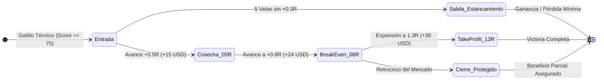

# 🛡️ Reglas de Riesgo y Cosecha Inteligente

  

    
Cosecha Parcial

    
0.5R

    
50% volumen cobrado (~ $15)

  

  

    
Break-Even Holgado

    
0.8R

    
Inmune al ruido inicial (~ $24)

  

  

    
Take Profit Final

    
1.3R

    
Salida antes de retrocesos (~ $38)

  

  

    
Filtro Estancamiento

    
5 Velas

    
Cierre si < 0.3R de avance

  

> [!IMPORTANT] La Naturaleza Cuantitativa del Oro (XAUUSD)
> El Oro es el activo con mayor porcentaje de retrocesos profundos (entre 50% y 78.6% de Fibonacci) durante la misma sesión. Esperar objetivos lejanos de 3.0R o $100 dólares sin asegurar beneficios convierte sistemáticamente trades con +$40 USD de beneficio flotante en pérdidas o en empates por Break-Even.

---

## 🔄 El Ciclo de Vida Cuantitativo del Trade

---

## ⚖️ Comparativa: Enfoque Clásico vs. Cosecha Inteligente

| Dimensión | Enfoque Clásico Minorista | Sistema Quantum de Cosecha Inteligente |
| :--- | :--- | :--- |
| **Objetivo de Salida** | Take Profit rígido en 3.0R o 4.0R | Take Profit realista en **1.3R** calibrado al ATR diario |
| **Gestión de Ganancias** | Todo o nada; no toma parciales | **Toma 50% en 0.5R**; transfiere dinero a la cuenta real |
| **Activación de Break-Even**| Muy temprana (0.3R), cazado por ruido | **Holgada en 0.8R**; permite la respiración natural del precio |
| **Factor Tiempo** | Deja órdenes abiertas indefinidamente | **Salida en 5 velas** si la velocidad de escape no existe |
| **Resultado Psicológico** | Frustración al ver retroceder ganancias | **Paz mental**: Cada impulso genera balance líquido seguro |

---

## 📋 Parámetros de Configuración por Bot

| Bot | Parcial (`partial_r`) | Break-Even (`break_even_r`) | TP (`risk_reward`) | Estancamiento (`stagnation`) |
| :--- | :---: | :---: | :---: | :---: |
| **[[Bot A - Alta Frecuencia]]** | `0.5R (50%)` | `0.8R (+2 pts)` | `1.3R` | 5 velas / 0.3R min |
| **[[Bot B - Max Beneficio]]** | `0.5R (50%)` | `0.8R (+2 pts)` | `1.3R` | 5 velas / 0.3R min |
| **[[Bot C - Sniper]]** | `0.5R (50%)` | `0.8R (+2 pts)` | `1.3R` | 5 velas / 0.3R min |
| **[[Bot D - Estancamiento]]** | `0.5R (50%)` | `0.8R (+2 pts)` | `1.3R` | **Sensor Primario (5 velas)** |

---

## 🔗 Navegación Rápida
- [[00 - Inicio|🏠 Volver al Panel Principal]]
- [[Resumen de la Flota|📊 Resumen de Rendimiento]]
- [[2026-09-18 - Leccion de Cosecha y Retrocesos en Oro|💡 Lección de Cosecha Histórica]]
- [[Glosario SMC Oro (XAUUSD)|🏛️ Glosario SMC]]
