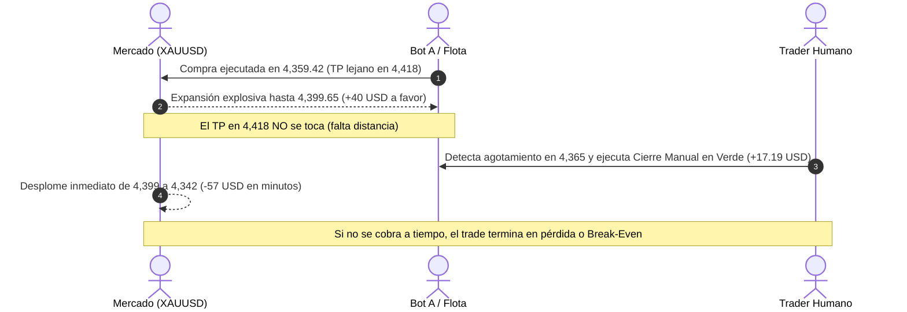

# 💡 Lección de Mercado · Cosecha Inteligente vs. Esperar el Milagro

  

    
Impulso Inicial

    
+$40.00 USD

    
Subida de 4,359 a 4,399

  

  

    
Retroceso Posterior

    
-$57.00 USD

    
Caída de 4,399 a 4,342

  

  

    
Ganancia Rescatada

    
+$17.19 USD

    
Cierre Manual a Tiempo

  

  

    
Regla Nueva

    
TP 1.3R + Parcial

    
Cosecha antes del retroceso

  

> [!QUOTE] La Regla de Oro Cuantitativa
> *"En el mercado del Oro (XAUUSD), los movimientos rectilíneos de más de $50 dólares sin retrocesos son una anomalía poco frecuente. Quien no toma beneficios en el camino, le devuelve todo su capital al mercado."*

---

## 📉 Reconstrucción Visual del Escenario (17 - 18 Septiembre)

---

## 📖 El Caso de Estudio Detallado

### 1. El Dilema del Take Profit Ambicioso
* El bot compró en **4,359** con un Take Profit inicial en **4,418** (casi $60 dólares de distancia teórica).
* El impulso matutino fue muy fuerte y llegó hasta **4,399.65** (+40 dólares de recorrido a favor).
* Sin embargo, como el Take Profit estaba fijado en 4,418, la orden quedó abierta esperando más.
* Minutos después, el oro sufrió un retroceso brutal de **4,399 a 4,342** (-57 dólares de desplome).
* Si el operador no hubiera cerrado en torno a **4,365**, ese retroceso habría borrado toda la ganancia acumulada, expulsando la posición en Break-Even o en Stop Loss.

---

## 🛠️ La Solución Definitiva: Los 4 Pilares de la Flota

```mermaid
graph TD
    P1["1. Toma Parcial en 0.5R (+15 USD)<br/>Cierra el 50% de la posición inmediatamente"] --> P2["2. Break-Even Holgado en 0.8R (+24 USD)<br/>No apretar el stop demasiado pronto"]
    P2 --> P3["3. Take Profit Final en 1.3R (+38 USD)<br/>Cobrar el 100% antes del retroceso"]
    P3 --> P4["4. Salida por Estancamiento (5 velas)<br/>Si el impulso se detiene, salir a mercado"]

    style P1 fill:#042f2e,stroke:#34d399,stroke-width:2px
    style P2 fill:#0f172a,stroke:#38bdf8,stroke-width:2px
    style P3 fill:#1e1b4b,stroke:#818cf8,stroke-width:2px
    style P4 fill:#451a03,stroke:#fbbf24,stroke-width:2px
```

---

## 🔗 Enlaces Relacionados
- [[Reglas de Riesgo y Cosecha Inteligente|🛡️ Manual de Cosecha Inteligente]]
- [[Bot D - Estancamiento|⏱️ BOT-D (Especialista en Salida por Tiempo)]]
- [[Resumen de la Flota|📊 Métricas de la Flota]]
- [[00 - Inicio|🏠 Volver al Panel Principal]]
